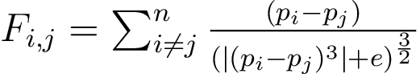

# N-Body Simulation — Performance Analysis Kernel

A 3D gravitational N-body kernel in C used as the starting point for a performance analysis and optimisation study: measuring a compute-bound kernel reliably, reading compiler optimisation reports, and adapting the code to the target architecture.

Coursework (AP project), Master CHPS. The full assignment, in French, is in [`doc/README.org`](doc/README.org) ([HTML version](doc/README.html)).

## The kernel

Each step computes all pairwise Newtonian interactions (O(n²)) with softening, then integrates velocities and positions. With `G = mᵢ = mⱼ = 1`, the force on particle *i* is:

<p align="center"></p>

The inner loop is counted at **17 floating-point operations per interaction**, which gives the reported GFLOP/s.

## Measurement protocol

The program runs the kernel **13 times**, discards **3 warm-up runs** and reports, for each run and on average:

- execution time (s), measured with `omp_get_wtime()`
- interactions per second
- GFLOP/s, with standard deviation over the measured runs

For stable numbers: fixed CPU frequency (`cpupower`, `performance` governor), process pinned to a non-zero core (`taskset`), laptop on mains power, native Linux (no VM), no other load.

## Build and run

```bash
cd src
make                          # gcc, -march=native, -O0 baseline, writes an optimisation report
taskset -c 2 ./nbody3D 1000   # n particles (default 16384)
```

The `-fopt-info-all` flag writes `nbody.gcc.optrpt`, the starting point for analysing what the compiler did (or failed to) vectorise.

## Optimisation directions

- Array-of-Structures → Structure-of-Arrays layout for unit-stride, vectorisable loads
- Removing `pow(d², 3/2)` in favour of `sqrt` / reciprocal square root
- Compiler and flag comparison (`-O2`, `-O3`, `-Ofast`, `-march=native`; gcc, clang, icx)
- Explicit SIMD and OpenMP multithreading

## Reference

M. Trenti and P. Hut, *Gravitational N-body Simulations*, Scholarpedia 3(5):3930, 2008 — [`doc/paper.pdf`](doc/paper.pdf).

## Author

**Ahmed Taleb Bechir**
[atbechir.com](https://atbechir.com) · [LinkedIn](https://www.linkedin.com/in/ahmed-taleb-bechir-97a7301a4) · [GitHub](https://github.com/talebbechir123)
